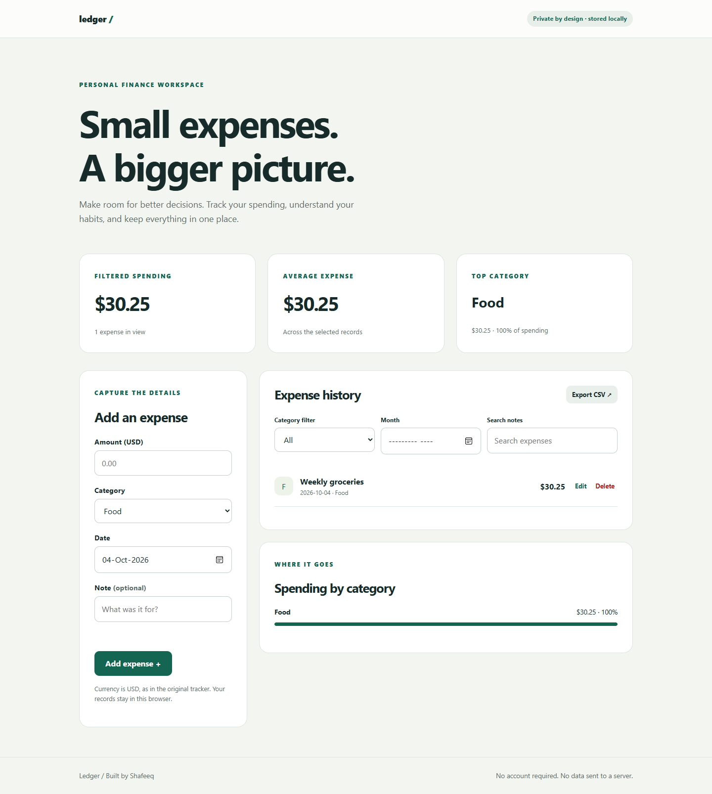

# Expense-Tracker-react

Ledger is a responsive React expense tracker with reliable local persistence, editable records, category and month filters, spending insights, and safe CSV exports. Migrated from Create React App to Vite.

## Run locally

```bash
npm ci
npm run dev
npm test
npm run build
```

Requires Node.js 22.12+ (Node.js 24 recommended).

## Data and privacy

Records are stored only in browser localStorage. USD is retained from the original project. Amounts use integer cents to avoid floating-point rounding errors. Existing `expenses` records migrate on startup without removing the original data. Old records have no date, so their migration date is used and their notes identify the migration.

Unreadable saved data is preserved. Download a raw backup before resetting it. CSV exports neutralize spreadsheet formula prefixes. Use **Export CSV** to back up your records before clearing browser data.

## Deployment

`npm run build` produces `dist/`. Host that directory on a static hosting service. Relative asset paths support deployment under a repository subdirectory.

## Development

Changes are checked by GitHub Actions. Keep credentials in environment variables and never commit `.env`, local databases, or build output.

## Preview



Local screenshot; transaction and registration fields use sample data.
